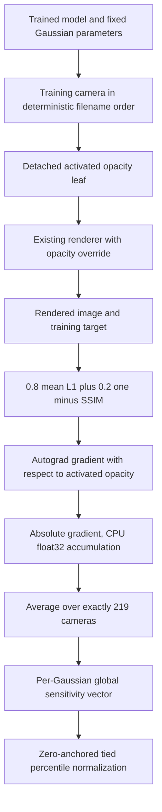
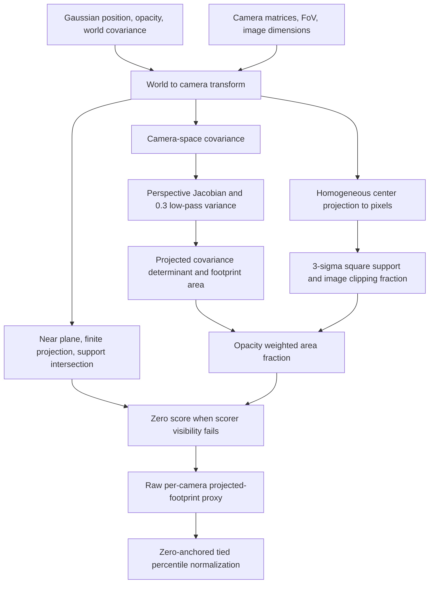
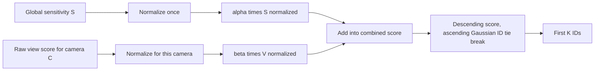
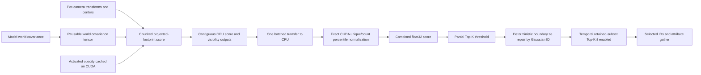

# Final Research Methodology

**Research title:** Sensitivity-Guided, View-Dependent Gaussian Selection for Efficient 3D Gaussian Splatting  
**Workspace:** `D:\3DGS-Research`  
**Status:** Methodology foundation, based on implemented and evaluated project artifacts

## 1. Research Overview

This work studies inference-time selection of a fixed-size subset of Gaussian primitives from an already trained Graphdeco 3D Gaussian Splatting (3DGS) model. The experiments compare a global activated-opacity score, a global gradient-sensitivity score, a camera-dependent projected-footprint proxy, weighted combinations of the latter two scores, and a sequential temporal-retention rule.

The selection process does not retrain the model. A Gaussian’s original model-row index is its stable Gaussian ID. A selected subset is formed by indexing the trained Gaussian attributes consistently and passing those attributes through the existing Graphdeco renderer and CUDA rasterizer. The CUDA rasterizer and original repository rendering path were not modified for the reported experiments.

The research methodology and the computational optimizations are distinct:

- **Research algorithm:** sensitivity scoring, projected-footprint scoring, weighted ranking, fixed-budget Top-K, and temporal retention.
- **Implementation optimizations:** exact partial Top-K, exact tied percentile normalization, batched score transfers, and reusable covariance matrices. These accelerate computations without changing the intended scores or selected IDs in their validated cases.

The view-dependent score is specifically an **opacity-weighted projected-footprint proxy**. It is not an estimate of the rasterizer’s exact front-to-back composited per-Gaussian contribution.

## 2. Problem Formulation

Let a trained model contain (N) Gaussian primitives with stable IDs (i\in\{0,\ldots,N-1\}). For a camera (C), selection returns a subset (\mathcal{A}(C)\) containing exactly (K) IDs, where the retention budget (p\in[0,1]\) sets

\[
K=\lfloor pN\rfloor.
\]

For the Truck model, (N=2{,}050{,}123). Tested budgets include 100%, 75%, 50%, 25%, 10%, and 5%, with the budget-specific exact counts recorded in the experiment reports. The objective is to study how score definitions and temporal constraints affect image quality, selection stability, and computation when only (K) Gaussians are supplied to the renderer.

The non-temporal combined selector defines a per-camera score (I_i(C)), sorts by descending score with Gaussian ID ascending as the deterministic tie-break, and takes the first (K) IDs. The temporal selector modifies this fixed-cardinality operation when a valid previous selection is available.

## 3. Gaussian Representation

Graphdeco’s `GaussianModel` stores per-Gaussian parameters including:

- World-space center (\boldsymbol{\mu}_i\in\mathbb{R}^3), from `_xyz` / `get_xyz`.
- Raw scale parameters, activated by exponentiation: (\mathbf{s}_i=\exp(\hat{\mathbf{s}}_i)\).
- Raw quaternion rotation, normalized by `rotation_activation`.
- Raw opacity logit (\hat{o}_i\), activated as (a_i=\sigma(\hat{o}_i)\), where (\sigma\) is the logistic sigmoid.
- Spherical-harmonic appearance coefficients (`_features_dc`, `_features_rest`); the trained model has maximum SH degree 3.

The covariance used by Graphdeco is built from scale and rotation. If (R_i) is the normalized quaternion-derived rotation matrix and (D_i=\mathrm{diag}(\mathbf{s}_i)\), the implementation forms (L_i=R_iD_i), then

\[
\Sigma_i=L_iL_i^\top.
\]

The six unique covariance entries are stored in the order ([xx,xy,xz,yy,yz,zz]\). The experiment scorer expands these entries into a symmetric (3\times3) matrix. The renderer additionally uses SH appearance to produce view-dependent color. The importance score itself does not use SH coefficients, color contrast, or target-image residuals except indirectly in the separate gradient-sensitivity computation.

## 4. Global Sensitivity Scoring

### 4.1 Loss and differentiated quantity

For each training camera (v), the baseline renderer produces image (I_v\) against ground-truth image (I_v^{gt}\). The sensitivity run uses the RGB loss

\[
\mathcal{L}_v=0.8\,\mathrm{meanL1}(I_v,I_v^{gt})+0.2\,[1-\mathrm{SSIM}(I_v,I_v^{gt})].
\]

The implementation uses `fused_ssim` when available (as it was in the recorded full run), and otherwise falls back to Graphdeco’s `utils.loss_utils.ssim`. There is no depth term.

For each camera, the activated opacity vector is detached and cloned as a leaf tensor requiring gradients. It is supplied to the existing renderer through a read-only model proxy. The run computes

\[
g_{i,v}=\frac{\partial\mathcal{L}_v}{\partial a_i},
\]

where (a_i\) is **activated opacity**, not the raw opacity logit. `torch.autograd.grad` obtains the gradient. No optimizer is created or stepped, and no model parameter is updated.

### 4.2 Aggregation over training cameras

The 219 training cameras are processed exactly once in deterministic, lexicographic image-name order at native resolution. Absolute gradients are accumulated sequentially in a CPU float32 vector and averaged:

\[
S_i=\frac{1}{V}\sum_{v=1}^{V}|g_{i,v}|,\qquad V=219.
\]

Thus (S_i\) is one nonnegative scalar per Gaussian. It is a local loss-derivative magnitude aggregated over the chosen training views and loss. It is not a leave-one-Gaussian-out ablation, a universal visual-contribution measure, or an intrinsic property independent of the objective and camera set.

### 4.3 Sensitivity normalization

Before combination, global sensitivity is mapped to ([0,1]\) using deterministic average-tie percentile ranks. Exact zero values are anchored at 0. The strictly positive values are ranked among the positive values; equal scores receive their shared midrank. If (m\) is the number of positive values and (r_i\) is the one-based average rank among those positive values, then

\[
\widetilde S_i=\begin{cases}
0,&S_i=0,\\
1,&S_i>0\text{ and }m=1,\\
\dfrac{r_i-1}{m-1},&S_i>0\text{ and }m>1.
\end{cases}
\]

The same global vector is reused for every camera. The zero anchor is intentional: it keeps zero sensitivity distinct from positive scores instead of allowing the large zero tie group to receive a nonzero midrank.

## 5. View-Dependent Scoring

### 5.1 Camera coordinates and projected center

For camera (C\), the scorer uses Graphdeco’s world-view and full projection transforms. With the repository’s tensor convention, a point is transformed to camera coordinates using the camera-view matrix; write the resulting coordinates as ((x_c,y_c,z_c)\). The homogeneous full-projection transform yields normalized-device coordinates, converted to pixels using the rasterizer convention

\[
x_{pix}=\frac{(x_{ndc}+1)W-1}{2},\qquad y_{pix}=\frac{(y_{ndc}+1)H-1}{2},
\]

where (W,H\) are the actual loaded image dimensions, 979 and 546 in the Truck experiments.

### 5.2 Projected covariance and footprint

The scorer mirrors the Graphdeco rasterizer’s covariance prepass, including its perspective clamp. Define

\[
\bar{x}_c=z_c\,\mathrm{clip}\!\left(\frac{x_c}{z_c},-1.3\tan\frac{\mathrm{FoV}_x}{2},1.3\tan\frac{\mathrm{FoV}_x}{2}\right),
\]

and similarly (\bar y_c\) using the vertical field of view. Focal lengths are (f_x=W/[2\tan(\mathrm{FoV}_x/2)]\) and (f_y=H/[2\tan(\mathrm{FoV}_y/2)]\). The implementation’s perspective Jacobian is

\[
J_i=\begin{bmatrix}
f_x/z_c&0&-f_x\bar{x}_c/z_c^2\\
0&f_y/z_c&-f_y\bar{y}_c/z_c^2
\end{bmatrix}.
\]

Let (R_{wc}\) be the camera-view rotation used by the scorer. The camera-space covariance and projected covariance are approximated as

\[
\Sigma_{i,c}=R_{wc}\Sigma_iR_{wc}^{\top},\qquad
\Sigma_{i,2D}=J_i\Sigma_{i,c}J_i^{\top}+0.3I_2.
\]

The (0.3I_2\) low-pass variance and the (1.3\tan(\mathrm{FoV}/2)\) clamp correspond to the inspected Graphdeco CUDA `computeCov2D`/preprocess path. The scorer calculates the 2D determinant (d_i=\det(\Sigma_{i,2D})\) after adding the low-pass variance. Its untruncated ellipse-area proxy is (2\pi\sqrt{\max(d_i,0)}\), capped at the full image area.

For clipping, the scorer mirrors the rasterizer’s maximum-eigenvalue radius convention:

\[
m_i=\tfrac12(\Sigma_{xx}+\Sigma_{yy}),\quad
\lambda_{max,i}=m_i+\sqrt{\max(0.1,m_i^2-d_i)},\quad
q_i=\left\lceil3\sqrt{\max(\lambda_{max,i},0)}\right\rceil.
\]

It forms an axis-aligned square of radius (q_i\) around the projected center and computes the fraction (c_i(C)\) of that square overlapping the image pixel rectangle ([-0.5,W-0.5]\times[-0.5,H-0.5]\). This square is used for support intersection and clipping only; the area term remains the determinant-based ellipse-area proxy.

### 5.3 Visibility and raw view-dependent score

The per-Gaussian visibility indicator in this scorer is 1 only when all of the following hold: camera-space (z_c>0.2\), homogeneous projection (w\) is finite and non-negligible, projected pixel coordinates are finite, and the projected 3-sigma support square intersects the image. The Graphdeco CUDA `in_frustum` helper itself enforces the near-plane condition; its lateral x/y test is commented out. The scorer adds its own image-support intersection rule. This is therefore the scorer’s visibility proxy, not an exact rasterizer visibility result.

With (A_{img}=WH\), the implemented raw score is

\[
V_i^{raw}(C)=\begin{cases}
a_i\,\dfrac{\min(2\pi\sqrt{\max(d_i,0)},A_{img})}{A_{img}}\,c_i(C),&\text{if scorer-visible},\\
0,&\text{otherwise}.
\end{cases}
\]

This is an **opacity-weighted projected-footprint proxy**. It does not model tile-level alpha compositing, occlusion, accumulated transmittance, SH color contrast, or image residual for the current view. It must not be described as true rasterizer-composited contribution.

### 5.4 View-score normalization

For each camera independently, (V^{raw}(C)\) is converted to (\widetilde V(C)\) by the same zero-anchored average-tie percentile rule used for sensitivity: exact zeros map to 0, positive ties receive their average rank among positive values, and the normalized values lie in ([0,1]\). Hence the view term is camera-dependent; the global sensitivity term is camera-independent.

## 6. Combined Scoring

The implemented hybrid score is

\[
I_i(C)=\alpha\widetilde S_i+\beta\widetilde V_i(C),\qquad \alpha,\beta\ge0,\quad\alpha+\beta=1.
\]

Here (\alpha\) weights normalized global sensitivity and (\beta\) weights normalized view-dependent proxy. The parameters are experimental weights, not learned values. Tested settings were:

| Name | (\alpha\) | (\beta\) | Meaning |
|---|---:|---:|---|
| Sensitivity-only | 1.00 | 0.00 | One global normalized sensitivity ranking |
| Sensitivity-dominant | 0.75 | 0.25 | Global sensitivity with a smaller view-dependent term |
| Equal weight | 0.50 | 0.50 | Equal normalized-score weights |
| View-dominant | 0.25 | 0.75 | Larger view-dependent term |
| View-only | 0.00 | 1.00 | Per-camera normalized view score |

The experiments do not establish a universally optimal pair. The weights are evaluated by budget and reported as distinct configurations.

## 7. Gaussian Top-K Selection

For score vector (Q(C)\) (activated opacity, normalized sensitivity, view-only score, or combined score), the deterministic ordering key is descending score followed by ascending original Gaussian ID. The selected set is the first

\[
K=\lfloor pN\rfloor
\]

IDs in that order. In the full-sort reference this is a lexicographic sort. In the exact partial implementation, a Kth-score threshold is found using `numpy.argpartition` (or a tested Torch top-k candidate); all scores strictly above threshold are included, and any boundary tie is filled by lowest original IDs. The chosen IDs are then ordered by the same score/ID rule. This returns the same ordered Top-K prefix as the full-sort reference for tested inputs.

For the opacity baseline, the ranking score is activated opacity (a_i\). For sensitivity-only, the score is (\widetilde S_i\) (a monotonic normalization of positive sensitivity values, with zeros anchored). For view-only and hybrid selection, the per-camera normalized view term or combined score is used.

Subset extraction indexes the selected ID list consistently into every per-Gaussian attribute required by the renderer: positions, activated opacity, scaling/covariance inputs, rotation, and SH features. The original IDs are retained in the experiment manifests; selection does not renumber the source model conceptually. The existing rasterizer is then called with the gathered subset. The original model and checkpoint remain unchanged.

## 8. Temporal Selection

### 8.1 Rule

Let (P_{t-1}\) be the previous camera’s selected set, with (|P_{t-1}|=K\). Let (\pi_t\) be the current camera’s complete deterministic ranking under the current score (I_i(C_t)\). Given retention parameter (R\in[0,1]\), the required number retained is

\[
K_R=\lceil RK\rceil.
\]

For a valid previous set, the selector orders members of (P_{t-1}\) by their current-frame score (the same score/ID ranking key) and takes the first (K_R\) as the mandatory retained subset (M_t\). It fills the remaining (K-|M_t|\) positions by traversing the current global ranking and skipping IDs already in (M_t\). Since non-mandatory previous IDs are not excluded from the fill list, they can be selected again if they rank highly; actual overlap can exceed the minimum.

If there is no previous set or it is malformed (wrong size, noninteger, out of bounds, or duplicated), the implementation falls back to ordinary current-frame Top-K and records the fallback. The first camera in each sequence intentionally uses this no-previous-selection fallback. A complete budget (K=N\) necessarily selects every ID.

### 8.2 Medium and Strong settings

- **Temporal Medium:** (R=0.95\); at least (\lceil0.95K\rceil\) previous IDs are retained.
- **Temporal Strong:** (R=0.98\); at least (\lceil0.98K\rceil\) previous IDs are retained.

The selected count remains exactly (K\) in both settings. Strong imposes a higher minimum overlap; it does not change the Gaussian score definition. Temporal selection is path-dependent: it assumes a defined camera order and prior selection. Its first-frame fallback and sequence-reset policy are part of the method.

## 9. Computational Optimization

These optimizations accelerate implementation of the above scores and selection. They do not change the research score definitions. Exactness claims below refer to comparisons against the original reference on the tested model, cameras, and budgets.

| Optimization | Original bottleneck | Implemented approach | Equivalence and validation | Measured impact / scope |
|---|---|---|---|---|
| Partial Top-K | Full stable sort of all (N\) scores for each selection | `numpy.argpartition` finds the Kth threshold; deterministic ID tie repair; only selected candidates are ordered | Exact ordered IDs matched reference full sort across tested cameras/methods/budgets; tie boundary tests included | Rank/select stage 6.48× at 10%, 9.33× at 5%; total selection path 1.37×/1.38× in five-camera pilot |
| Percentile normalization | Stable sorting every positive score and expanding per-element tie groups | Sorted unique values/counts and inverse mapping on CPU or CUDA; rank group midpoints map to same percentiles | Candidate normalized vectors were bitwise identical; combined vectors, rankings, and selections matched | CUDA unique mean 43.38 ms vs 247.41 ms reference (5.70× isolated); pipeline gains were smaller due to other stages/transfers |
| Batched view-score computation | Repeated opacity transfers, per-chunk output copies, finite-check synchronization | Cache activated opacity on CUDA; write chunk outputs to contiguous CUDA arrays; transfer completed arrays once | Raw score/visibility arrays bitwise identical; selected IDs matched | Five-camera score time 438.79→389.25 ms (1.127×); combined six-configuration pipeline 620.02→577.47 ms/camera (1.074×) |
| Reusable covariance matrices | Expand six world-covariance values and repeatedly construct per-camera operations | Precompute per-Gaussian symmetric world covariance matrices once and reuse; each camera still applies its own world-to-camera covariance transform | Cached-matrix and explicit-BMM paths were bitwise identical in covariance, score, and ordered IDs | Cached matrix covariance stage 316.30→308.56 ms (1.025×); cache about 73.8 MB and about 7.8 ms setup in the five-camera study |

The covariance cache is a reusable **world-space covariance tensor**, not a cache of camera-specific transformed covariance values. Camera transforms remain view-dependent. The transposed multiplication and explicit symmetric scalar formula were also profiled, but floating-point reassociation changed score values and ordered IDs; they are not classified as exact or adopted as exact pipeline optimizations. In the tested five-camera cases, top-K sets happened to match, but that does not establish bitwise or ordering equivalence.

The consolidated exact pipeline combined the exact partial selection, CUDA percentile normalization, batched view-score output, and covariance reuse. On its five-camera profile it measured 3.50× at 10% and 3.54× at 5% versus its original reference. A separate full 219-camera selector validation measured optimized exact speedups of 3.80×, 3.25×, 4.22×, and 4.10× at 50%, 25%, 10%, and 5%, respectively. These are selector-path timings, not rendering FPS.

## 10. Experimental Setup

### Hardware and software

| Component | Recorded setup |
|---|---|
| CPU | Intel Core i5-13450HX |
| System RAM | 16 GB |
| GPU | NVIDIA GeForce RTX 3050 Laptop GPU, 6 GB VRAM (6144 MiB) |
| NVIDIA driver | 581.86 |
| CUDA Toolkit | 12.8 (installed toolkit); experiments report PyTorch CUDA 12.8 |
| Python | 3.11.18 in the existing 3DGS environment |
| PyTorch | 2.11.0+cu128 |
| Repository | Original Graphdeco `gaussian-splatting` implementation and its existing CUDA rasterizer |

### Dataset and model

- Dataset: Tanks and Temples Truck; 251 JPG images, all 979×546.
- Sparse reconstruction: one PINHOLE camera model, 251 registered image poses, 136,029 initial COLMAP points.
- Evaluation split: with Graphdeco `--eval`, camera records are sorted by image name and every eighth sorted record is held out, yielding 32 test and 219 training cameras.
- Baseline: original Graphdeco training, 30,000 iterations, maximum SH degree 3, native image resolution, CPU camera-image storage, and evaluation split enabled. The baseline `cfg_args` records `resolution=1`, `data_device='cpu'`, `eval=True`, `sh_degree=3`. The experiment reports identify the standard Graphdeco training schedule; the algorithm/source was not altered.
- Model state: `chkpnt30000.pth` and `point_cloud/iteration_30000/point_cloud.ply`; the inference PLY has 2,050,123 rows, matching checkpoint Gaussian positions.
- Calibration caveat: the stored images are approximately half the COLMAP metadata dimensions. The repository loader’s camera FoV behavior was retained in all experiments; no dataset calibration or source correction was introduced. This is a common inherited condition of the reported results.

### Evaluation splits by experiment

The global opacity, sensitivity, combined, and weight-sweep rendering benchmarks use the same 32 official test cameras. Global sensitivity computation and the full-scale scalability/stability experiments use training cameras only. The temporal rendering pilot uses 20 evenly spaced filename-ordered training cameras. No temporal rendering quality result should be described as a 32-test-camera or 219-camera rendering evaluation.

## 11. Evaluation Metrics

### Image quality

- **PSNR:** Graphdeco’s helper computes per-image MSE over image channels and pixels, then (20\log_{10}(1/\sqrt{\mathrm{MSE}})\), equivalent to (-10\log_{10}(\mathrm{MSE})\) for unit-range images. Benchmark reports compute metrics from saved 8-bit PNGs against paired saved ground-truth PNGs and report arithmetic means across the evaluation camera set.
- **SSIM:** Graphdeco’s SSIM helper uses an 11×11 Gaussian window with standard deviation 1.5, constants (C_1=0.01^2\), (C_2=0.03^2\), and averages the SSIM map. Benchmark quality uses saved PNGs and reports the mean across cameras. The sensitivity loss uses fused SSIM when available and is not the same evaluation aggregation path as a saved-PNG report.
- **LPIPS:** Not computed; pretrained weights were unavailable locally and no download was performed.

### Throughput and latency

- **Rendering throughput / render-call FPS:** In the Top-K rendering benchmarks, CUDA is synchronized around each render call. FPS is the number of rendered camera calls divided by measured render-call wall time (or the report’s stated aggregate of per-camera reciprocal timings). It excludes image writing and excludes selection unless expressly stated. It includes caller-visible Python and GPU completion time; it is not kernel-only FPS.
- **End-to-end throughput:** In the temporal rendering pilot, per-camera time is selection time plus mean synchronized render-call time, and end-to-end FPS is the reciprocal of that combined per-camera time. Selection includes view-score generation, per-camera normalization/ranking, the temporal or baseline selector, and subset gather; shared global sensitivity normalization is excluded as a one-time cost. In other benchmarks, cached and uncached end-to-end definitions are reported separately and must not be conflated.
- **Selection latency:** Wall-clock time for the defined selector pipeline. The full-scale scalability benchmark times scoring through selected attribute access/gather with synchronized asynchronous GPU work. It does not include rasterization or rendering.

### Temporal stability

For adjacent selections (A_t,A_{t-1}\), each of size (K\), let (q=|A_t\cap A_{t-1}|\).

\[
\mathrm{overlap}=q/K,\qquad
\mathrm{Jaccard}=\frac{q}{|A_t\cup A_{t-1}|}=\frac{q}{2K-q},\qquad
\mathrm{changed\%}=100\frac{K-q}{K}.
\]

Reports aggregate these quantities over valid adjacent transitions. The initial frame has no preceding selection and is excluded from transition means. These set metrics do not measure rendered image quality or perceptual flicker.

### Memory

PyTorch **allocated** and **reserved** VRAM peaks are tracked separately. Process RAM is reported as resident set size (RSS) where available. `nvidia-smi` device-wide memory is a separate observation and can include other processes; it is not interchangeable with PyTorch allocator measurements.

## 12. Experiment Design

| Experiment group | Research question | Method | Evaluation set | Budgets | Metrics / purpose |
|---|---|---|---|---|---|
| 1. Baseline evaluation | What is the full-model reference? | Original Graphdeco iteration-30K model, unchanged renderer | 219 train renders and 32 official test renders for baseline report | 100% | PSNR, SSIM; LPIPS unavailable; reference render throughput |
| 2. Opacity Top-K | How does a global activated-opacity ranking trade quality for smaller rasterizer input? | Sort (a_i=\sigma(\hat{o}_i)\), gather Top-K subset | 32 test cameras | 100, 75, 50, 25, 10, 5% | PSNR, SSIM, synchronized render-call FPS, memory |
| 3. Sensitivity Top-K | Does global loss-gradient ranking differ from opacity and affect held-out quality? | Accumulate activated-opacity gradients over 219 train views; use one global Top-K ranking | Sensitivity computed on 219 train; quality on same 32 test cameras | 100, 75, 50, 25, 10, 5% | Gradient validity/distribution; ranking overlap; PSNR, SSIM, FPS |
| 4. View-dependent scoring pilot | Does projected footprint score vary by camera and compute safely? | Score every Gaussian for three deterministic train cameras; no render benchmark | Train camera loader indices 0, 109, 218 | Full score vector | Score distribution, visible/zero counts, top IDs, rank correlations, finite/range checks |
| 5. Sensitivity + view weight sweep | How do fixed alpha/beta choices affect camera-specific Top-K quality? | Combine normalized global sensitivity and per-camera normalized view proxy | 32 official test cameras; cached view scores in sweep | 50, 25, 10, 5% | PSNR, SSIM, render-call and separately defined end-to-end throughput, repeatability |
| 6. Temporal selection pilot | Can a minimum-retention rule stabilize selections over the training trajectory? | Sequential current-score ranking with previous-set retention | All 219 filename-ordered training cameras | 50, 25, 10, 5%; R=.90/.95/.98 | Overlap, Jaccard, changed IDs, count/bounds/determinism; no rendering |
| 7. Temporal rendering pilot | Does temporal retention affect quality and throughput along a camera path? | Per-camera baseline vs Medium/Strong temporal selection using alpha/beta=.75/.25 | 20 evenly spaced training cameras | 10, 5% | PSNR, SSIM, synchronized render FPS, end-to-end FPS, overlap, descriptive non-flow-compensated adjacent RGB MAE |
| 8. Selection pipeline optimization | Which exact computations dominate selection and can they be accelerated? | Profile and compare partial Top-K, normalization, batched scores, covariance candidates | Primarily five deterministic training cameras; profiling subset also documented in each report | Mainly 10, 5% for optimization profiles | CPU wall/CUDA event timings, exactness, ranking/ID equality, memory, integrity |
| 9. Full-scale scalability validation | Does the complete selector execute over the whole training camera path with valid outputs and bounded memory? | Original reference, optimized exact, Medium, Strong; correctness oracles outside timed interval | All 219 training cameras; no test cameras/images | 50, 25, 10, 5% | Per-stage and total selection wall time, temporal stability, VRAM/RSS, exactness, integrity |

## 13. Algorithm Pseudocode

The pseudocode below describes the implemented process at a conceptual level. It omits file I/O, integrity hashing, and runtime telemetry. The scorer’s equations and edge cases are defined in Sections 4–8.

### Algorithm 1: Global sensitivity computation

```text
Input: trained model M, ordered training cameras C[1..V], V=219
Output: CPU float32 sensitivity S[0..N-1]

S <- zeros(N, float32, CPU)
for camera C_v in deterministic image-name order:
    a <- detach_clone(sigmoid(model.opacity_logits))
    set requires_grad(a, true)
    render I_v using existing renderer with opacity override a
    L_v <- 0.8 * mean_L1(I_v, GT_v) + 0.2 * (1 - SSIM(I_v, GT_v))
    g <- autograd.grad(L_v, a)
    assert each gradient entry is finite
    S <- S + abs(g).flatten().to(CPU, float32) / V
    release view graph and temporary GPU tensors
return S
```

### Algorithm 2: View-dependent score computation

```text
Input: Gaussian centers, activated opacity, world covariance; camera C
Output: raw view score V_raw[0..N-1], scorer visibility flag

for Gaussian chunks:
    transform centers into camera and clip coordinates
    project centers to pixel coordinates using Graphdeco transforms
    transform each world covariance to camera coordinates
    apply Graphdeco perspective Jacobian and add 0.3 * I to 2D covariance
    compute determinant-based ellipse-area proxy, capped at image area
    compute Graphdeco-style 3-sigma radius
    form axis-aligned support square and calculate in-image square fraction
    visible <- (camera_z > 0.2) AND finite projection AND support intersects image
    V_raw <- activated_opacity * (capped_area / image_area) * square_clip_fraction
    set V_raw to 0 where not visible
return V_raw and visibility
```

### Algorithm 3: Combined Gaussian selection

```text
Input: global sensitivity S, camera C, alpha, beta, retention budget p
Output: ordered selected Gaussian IDs

S_norm <- zero-anchored average-tie percentile(S)  # once per model
V_raw <- Algorithm2(model, C)
V_norm <- zero-anchored average-tie percentile(V_raw)
I <- alpha * S_norm + beta * V_norm
K <- floor(p * N)
rank IDs by descending float32 I, then ascending original Gaussian ID
select first K IDs (full sort or exact threshold/partial Top-K with tie repair)
gather every renderer input attribute using those same IDs
render with the unchanged Graphdeco renderer/rasterizer
```

Endpoint settings (\alpha=1,\beta=0\) and (\alpha=0,\beta=1\) implement sensitivity-only and view-only selection, respectively. Opacity Top-K is a separate baseline whose ranking score is activated opacity.

### Algorithm 4: Temporal Gaussian selection

```text
Input: current full ranking pi_t, budget K, previous IDs P, retention R
Output: exactly K ordered IDs and fallback status

required <- ceil(R * K)
if P absent or invalid:
    return first K IDs of pi_t; record fallback
rank members of P by their current-frame score (current ranking order)
mandatory <- first required previous IDs
fill <- traverse pi_t, skipping only IDs already in mandatory,
        until K - size(mandatory) additional IDs have been collected
selected <- mandatory followed by fill
assert size(selected) == K and |selected intersect P| >= required
return selected
```

For partial Top-K, the implementation computes the required current-score Top-K within the previous set, then fills from the complement of mandatory retained IDs using the same deterministic threshold/tie procedure. This preserves exact selected IDs/order relative to the full-sort temporal reference in the validated conditions.

## 14. Research Pipeline Diagrams

### Figure 1 — Overall research pipeline


### Figure 2 — Global sensitivity scoring pipeline



### Figure 3 — View-dependent scoring pipeline



### Figure 4 — Combined sensitivity and view-dependent ranking



### Figure 5 — Temporal Gaussian selection mechanism

```mermaid
flowchart TD
    A[Current camera score and deterministic ranking] --> B{Valid previous K-ID set?}
    B -- No --> C[Fallback to ordinary current Top-K]
    B -- Yes --> D[Compute required count ceil(R times K)]
    D --> E[Rank previous IDs by current camera score]
    E --> F[Retain required highest-ranked previous IDs]
    F --> G[Fill remaining slots from current ranking, skipping mandatory IDs]
    G --> H[Exactly K IDs; actual overlap may exceed minimum]
    C --> I[Current selected set]
    H --> I
    I --> J[Use as previous set for next ordered camera]
```

### Figure 6 — Optimized computational pipeline



Figure 6 describes the validated optimization candidates. The operation ordering shown is conceptual: global sensitivity normalization is model-level and reusable, while view scoring/normalization is per camera; temporal selection is optional. The camera covariance transform still occurs for each camera.

## 15. Implementation Details

- **Code isolation:** research scorers, temporal selector, and optimization candidates were maintained in experiment-specific files/directories. Original Graphdeco repository source and CUDA rasterizer were left unchanged.
- **Renderer compatibility:** subset rendering uses the existing renderer interface and rasterizer; all selected per-Gaussian fields share one ID vector. The full-set 100% runs served as a correctness control and matched baseline pixels in the cited benchmarks.
- **Stable identity:** Gaussian ID is the zero-based row in the iteration-30,000 PLY/checkpoint tensors. The pilot verified row positions against the checkpoint. Selection manifests store IDs/order or hashes.
- **Camera order:** scoring and temporal experiments use deterministic filename ordering. The temporal results depend on that order; the path is not arbitrary independent-camera selection.
- **Normalization:** zeros remain exactly zero. Positive score ties share average midrank; optimized unique/count normalization was bitwise compared with the reference. The normalizer does not use min-max scaling.
- **Exact partial ranking:** argpartition only finds the score threshold; deterministic tie repair selects the lowest original IDs among boundary ties, and the final chosen IDs are placed in score/ID order. It is not an approximate unsorted argpartition prefix.
- **Covariance cache scope:** the reusable cache stores world-space per-Gaussian covariance matrices. Camera-specific transforms and projected covariance remain view-dependent.
- **Integrity:** the experiment reports provide hashes for protected model, score, dataset, source, and previous-output files, with unchanged hashes in the reported runs.

## 16. Methodological Limitations

1. The experiments use one scene and one trained model. Generalization to other scenes, camera paths, resolutions, model sizes, or GPUs is unknown.
2. Sensitivity is a local derivative magnitude for one chosen RGB loss and the 219 training cameras. It does not equal removal impact and can assign zero where no local gradient was measured for those views.
3. The view-dependent term is an approximate projected-footprint/opacity proxy. The approximate square clipping, center/support visibility rule, and omitted compositing effects prevent interpreting it as true rasterizer contribution.
4. Temporal rendering quality was evaluated on only 20 sampled training cameras. The complete 219-camera run validated selection and timing, not rendered quality over the full path. No temporal rendering evaluation used the official 32 test views.
5. Adjacent rendered RGB MAE was not optical-flow compensated. Selection overlap, Jaccard, and changed-ID percentages describe set stability only; they do not prove perceptual flicker reduction.
6. The 32-camera test set is a holdout view set, not a verified video sequence. Temporal selection assumes an ordered path and an available prior subset.
7. LPIPS was unavailable because pretrained model weights were not cached. PSNR and SSIM do not fully characterize perceptual fidelity.
8. Camera image dimensions and COLMAP calibration dimensions differ in the downloaded dataset. All experiments retained the established Graphdeco loader/calibration behavior; conclusions are conditional on that shared camera setup.
9. Timing results use different protocols, camera subsets, and timer boundaries. Render-call FPS, end-to-end FPS, and selection latency are distinct; the five-camera consolidated temporal integrated measurements had an in-timer oracle caveat and are not treated as clean operational timing.
10. Exactness was validated over recorded camera/model/budget conditions. It should not be generalized to all floating-point backends or inputs without rerunning equivalence tests.

## Methodology Verification Checklist

- [x] Every equation corresponds to the sensitivity, projected-footprint, normalization, ranking, or temporal implementation described in the existing reports and experiment scripts.
- [x] Every algorithm corresponds to implemented functionality; pseudocode abstracts telemetry and file handling only.
- [x] The view-dependent score is identified as an opacity-weighted projected-footprint proxy, not true composited rasterizer contribution.
- [x] Temporal retention uses the previous fixed-size set, current-camera ranks, (\lceil RK\rceil\) minimum retention, exact-size fill, and first/invalid-state fallback.
- [x] Exact partial selection, normalization, batched scoring, and cached world covariance are distinguished from non-exact floating-point reassociation candidates.
- [x] No universal superiority, multi-scene generalization, or perceptual flicker claim is made.
- [x] No experiment results are invented; result quantities are included only where needed to specify measured optimization impact, and are attributed to their original validation scope.
- [x] The baseline model, dataset split, hardware, software, metric definitions, and temporal camera subset are taken from existing project records.

## Implementation and report sources consulted

- `MASTER_RESEARCH_RESULTS_CONSOLIDATION.md`
- `SYSTEM_INFO.md`
- `TRUCK_DATASET_INSPECTION_REPORT.md`
- `BASELINE_TRAINING_CONFIGURATION.md`
- `BASELINE_RENDERING_AND_EVALUATION.md`
- `experiments\baseline_truck\cfg_args`
- `experiments\sensitivity_full_219views\SENSITIVITY_FULL_219VIEW_REPORT.md`
- `experiments\sensitivity_full_219views\compute_sensitivity_219views.py`
- `experiments\view_dependent_scoring_pilot\VIEW_DEPENDENT_SCORING_PILOT_REPORT.md`
- `experiments\view_dependent_scoring_pilot\compute_view_dependent_scores.py`
- `experiments\temporal_selection_pilot\TEMPORAL_SELECTION_PILOT_REPORT.md`
- `experiments\temporal_selection_pilot\temporal_selection.py`
- `experiments\partial_topk_optimization\exact_partial_topk.py`
- `experiments\view_score_normalization_optimization\normalization_methods.py`
- `experiments\view_score_computation_optimization\score_candidates.py`
- `experiments\camera_space_covariance_optimization\CAMERA_SPACE_COVARIANCE_OPTIMIZATION_REPORT.md`
- `experiments\sensitivity_view_weight_sweep\SENSITIVITY_VIEW_WEIGHT_SWEEP_REPORT.md`
- `experiments\temporal_rendering_pilot\TEMPORAL_RENDERING_PILOT_REPORT.md` and `run_temporal_rendering_pilot.py`
- `experiments\consolidated_pipeline_benchmark\CONSOLIDATED_PIPELINE_BENCHMARK_REPORT.md`
- `experiments\full_scale_scalability_validation\FULL_SCALE_SCALABILITY_VALIDATION_REPORT.md`
- Graphdeco `scene/gaussian_model.py`, `utils/general_utils.py`, `utils/graphics_utils.py`, `utils/image_utils.py`, `utils/loss_utils.py`, and `submodules/diff-gaussian-rasterization/cuda_rasterizer/{forward.cu,auxiliary.h}`
