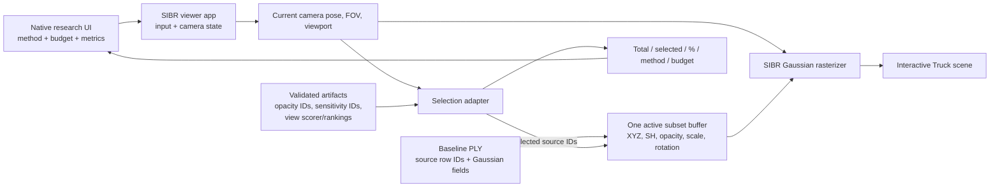

# Interactive 3DGS Viewer Feasibility Report

**Date:** 2026-11-21  
**Scope:** Read-only architecture and artifact audit. No application was implemented, no source/model/data/results were changed, and no packages or data were installed or downloaded.

## 1. Executive summary

The Truck baseline is suitable for interactive viewing with Graphdeco's SIBR real-time Gaussian viewer. The checkout contains the viewer source and the baseline has the expected iteration-30,000 Gaussian PLY and `cfg_args`. The SIBR renderer loads the trained PLY attributes (means, SH, opacity, scale, rotation), renders splats, and provides FPS and trackball navigation. However, no compiled `SIBR_gaussianViewer_app.exe` was found in the repository or the inspected project directories.

SIBR can load a selected-subset PLY because its loader reads a PLY's vertex rows and Gaussian properties. Its current application does not expose runtime model swapping, a selection-method selector, or a Gaussian-budget slider. PLY snapshots can therefore be viewed by launching/reloading each model, but interactive technique switching requires application changes or a companion selection service. Dynamic hybrid selection depends on the active camera and cannot be represented by one fixed PLY for all views.

**Recommended direction:** a hybrid native architecture based on SIBR's existing authentic 3DGS renderer and camera controls, with a small research UI for method/budget controls. Initially reuse saved rankings and validated camera-specific hybrid rankings; keep the original renderer and CUDA rasterizer intact. To support arbitrary live camera movement with hybrid scoring, add a selector interface that receives the native viewer camera, returns selected original Gaussian IDs, and updates the active Gaussian buffers. This is a meaningful integration project and should be a distinct optional experimental path.

The audit found **0 bytes free on D:** at inspection. This blocks a viewer build, large PLY materialization, or application output until space is available. SIBR's documented Windows build path downloads/builds external dependencies; its official prebuilt viewer is also a download. The user prohibited downloads and installations for this audit, so neither was attempted.

## 2. Existing project architecture

### Baseline and data

- Repository: `gaussian-splatting/`
- Baseline model: `experiments/baseline_truck/`
- Dataset: `training_data/truck_baseline/`
- Baseline Gaussian PLY: `point_cloud/iteration_30000/point_cloud.ply`
- Baseline size: 2,050,123 Gaussians; the PLY contains position, opacity, scale, rotation, and degree-3 SH fields.
- Training sequence: 219 filename-ordered cameras; images are 979×546. The existing training/test split has 219 training and 32 evaluation cameras.

### Graphdeco Python rendering path

`scene/gaussian_model.py` exposes row-aligned Gaussian fields through `get_xyz`, `get_opacity`, `get_scaling`, `get_rotation`, and `get_features`/SH. `gaussian_renderer/__init__.py::render` constructs `GaussianRasterizationSettings` from the camera and passes those tensors into `GaussianRasterizer`; the renderer returns the image, radii, and depth. `scene/cameras.py::Camera` provides projection/view transforms, dimensions, FOV, and camera center.

The Python path is already validated for offline rendering and subset gathers. It does not provide a GUI, event loop, continuously updated camera object, or hot-swappable model UI. Building a desktop app around it would require a windowing/UI layer and careful coordination of the render loop, CUDA work, camera transforms, and model tensors.

### Graphdeco SIBR path

The source under `gaussian-splatting/SIBR_viewers/src/projects/gaussianviewer/` is a native C++/CUDA/OpenGL Gaussian renderer. In `renderer/GaussianView.cpp`, `loadPly` reads Gaussian properties from a PLY and `GaussianView` uploads them into Gaussian render buffers. `onRenderIBR` renders the current scene; `onUpdate` and SIBR's view/navigation system handle input; `onGUI` currently offers render mode, scaling, culling, antialiasing, crop controls, and export. `apps/gaussianViewer/main.cpp` parses the model path, reads `cfg_args`, and creates the scene/view.

Graphdeco's `README.md` documents launching `SIBR_gaussianViewer_app -m <trained model path>`, FPS/trackball navigation, dataset camera snapping, and a 4 GB VRAM recommendation for the viewer. The viewer uses its own real-time rasterization path rather than calling the Python `gaussian_renderer.render` function. It is still an authentic 3D Gaussian renderer, but performance/render details need not be pixel-identical to the Python training rasterizer.

## 3. Available Gaussian data and selection outputs

All fields needed by the renderer are in the iteration-30,000 PLY and retain Gaussian row identity. Existing selection pipelines operate on source row IDs; they gather aligned Gaussian attributes and have been validated with Graphdeco's Python renderer.

Available existing artifacts include:

- **Opacity Top-K:** quality/timing results under `experiments/fixed_topk_benchmark/`; the reusable opacity-ranking and subset implementation is `gaussian-splatting/experiments/fixed_topk/opacity_topk.py`. The ranking can be regenerated from the baseline opacity values; the audit did not assume a persisted global opacity ID file.
- **Global sensitivity:** the full 219-training-view score vector at `experiments/sensitivity_full_219views/sensitivity_scores_219views.npy`; global selected IDs at `experiments/sensitivity_topk_benchmark/results/selected_gaussian_ids.json`.
- **Hybrid sensitivity + view-dependent:** the validated scorer at `experiments/view_dependent_scoring_pilot/compute_view_dependent_scores.py`; camera-specific rankings and score arrays at `experiments/sensitivity_view_topk_benchmark/`; benchmark report and results are in that directory. The established hybrid used normalized global sensitivity plus camera-dependent projected-footprint proxy (alpha=beta=0.5 for the full test benchmark). This is a proxy, not exact rasterizer-composited contribution.
- **Temporal hybrid:** validated sequential IDs and render artifacts under `experiments/temporal_rendering_pilot/`. These sets depend on chronological camera order and previous selected IDs; they cannot be regenerated independently per arbitrary orbit view while claiming the same temporal rule.
- **Camera parameters:** the dataset loader and validated sequence manifests preserve original camera transforms, FoV, and dimensions.

For a live application, budget `K=floor(pN)` with deterministic ranking/tie-breaking, then gather every renderer input by the same selected ID vector. At 100%, the original model/order should be used directly to preserve the baseline path. Cache global sensitivity normalization once per model. Reuse stored camera rankings only when the active camera exactly matches a validated camera. For arbitrary camera movement, recompute the view score or explicitly snap to/quantize camera states; do not silently label a cached nearby-camera score as the exact current view.

## 4. Comparison of implementation approaches

| Option | Advantages | Disadvantages / work | Fidelity and interaction | Switching/budget | RTX 3050 memory outlook | Assessment |
|---|---|---|---|---|---|---|
| **A. Modify SIBR** | Existing native Gaussian rendering, PLY loading, trackball/FPS controls, OpenGL/CUDA path; likely strongest interactive performance. | C++/CUDA/OpenGL integration; add controls, selection and buffer updates; source build needs compatible dependencies. Changes Graphdeco viewer source and requires maintenance. | Actual Gaussian splatting and native camera controls. | Straightforward for fixed/global scores once rankings and buffers are wired. Hybrid requires camera access and per-view scoring; temporal needs state. Existing program loads model at startup and has no model/budget UI. | Existing viewer recommends 4 GB VRAM; 6 GB GPU is plausible, subject to desktop GPU use and display driver. Full PLY plus working buffers may be material. | Viable renderer foundation; do changes in a research fork/branch, not baseline source. |
| **B. Custom Python desktop app using Graphdeco renderer** | Reuses already-tested `gaussian_renderer.render`, model fields, scorers and subset modules; quickest path for research correctness. | Must supply a GUI/window/event loop, live camera control, input handling, frame scheduling, model caching and robust CUDA lifecycle. Existing training renderer is not a ready viewer. Python per-camera hybrid score is costly; prior measured pipeline is roughly 1.1 s/camera uncached. | Exact existing Python rasterizer path; interactive camera may feel slow unless view scoring is optimized/cached. | UI integration is flexible. Fixed/global selection easy; hybrid recomputed for each camera can stall; temporal selection requires prior-frame state. | Prior Python rendering runs were below 2 GB allocated for selected subsets in cited pilots; full model and interactive app overhead vary. 6 GB is plausible but must be profiled. | Best research reference/prototype if a Python UI is available, but not best smooth interactive viewer. |
| **C. Browser UI + Python backend** | Familiar UI controls, rapid dashboard work, easy metrics panel, potential remote/local client split. | Browser cannot call Graphdeco's CUDA extension directly. Backend must own the render loop and return image frames; camera updates, IPC/WebSocket, image encoding, latency and lifecycle add complexity. A browser-native Gaussian renderer would be a second renderer and may differ from Graphdeco. | Authentic 3DGS only if backend uses Graphdeco/SIBR; browser view itself is then streamed frames. WebGL/WebGPU rendering could be authentic Gaussian splatting in general, but not the original Graphdeco pipeline and needs a separate implementation. | UI switching possible through backend commands; dynamic selection requires server-side camera-conditioned ranking and buffer changes. | Backend and browser share the one GPU; full model plus display/browser and frame buffers compete for 6 GB. Streaming adds CPU/memory overhead. | Not recommended as the first prototype; use only if a web dashboard is a firm product requirement. |
| **D. Native renderer + research dashboard (recommended)** | SIBR keeps actual Gaussian rendering and mature camera navigation; a focused UI controls method/budget and shows counts. Can separate UI, selector, and renderer contracts. | Requires extending/wrapping SIBR to expose camera pose and accept ID/buffer updates. A separate dashboard may need IPC. Need build/runtime work and GPU/resource profiling. | Native 3DGS viewer path and responsive camera interaction. | Global/opacity can switch from precomputed IDs. Hybrid can update from exact viewer camera via selector service or embedded C++/CUDA implementation. Temporal can be an optional stateful mode along a defined path, not an arbitrary stateless orbit. | Best chance to stay within the viewer's 4 GB recommendation, but 6 GB remains a constrained target and must be measured. Avoid retaining multiple full duplicate GPU models. | Most balanced architecture for the stated actual-Gaussian viewer plus research controls. |

### Option A: specific loading behavior

SIBR's PLY loader can load the baseline and any subset PLY that preserves supported Gaussian fields. It loads the path supplied at startup and uploads model arrays. The current `GaussianView::onGUI` contains no technique or budget selector and no model hot-swap API. One can relaunch it with another model directory, or implement a safe reload/buffer-update path. Keeping multiple full model copies resident is unnecessary and undesirable; selected IDs plus one active gathered buffer are preferable. Switching fixed/global subsets may be done by re-indexing active buffers. On-demand PLY reload is simpler but has disk I/O and visible latency.

## 5. Proposed architecture and data flow

The selection adapter should have a stable contract: inputs are technique, percentage, current camera state and (only for temporal mode) previous IDs; outputs are unique deterministic source IDs of exact budget size plus timing/count metadata. The renderer gathers all required attributes by those IDs and renders them using its Gaussian pipeline. The metrics panel reports the actual count passed to the rasterizer.

### Data flow

1. Load one baseline Gaussian model and validated static score/ranking artifacts.
2. Build/cache global sensitivity rank once; retain original row IDs.
3. On method/budget change, compute `K=floor(pN)` and create a deterministic selected-ID set. Opacity/global sensitivity can use cached global rankings.
4. For hybrid, read the viewer camera pose and compute the existing footprint proxy for that pose (or use a cache keyed by exact camera transform/FoV/viewport); combine with global sensitivity rank and choose exact K.
5. Gather aligned Gaussian fields into one active buffer, update the renderer, and display the scene with unchanged camera controls.
6. Refresh method/count/retention labels. Temporal mode is sequential and records previous IDs; reset camera/path also resets temporal state.

## 6. Camera, fidelity, and selection details

SIBR already provides FPS and trackball navigators. The application should retain these and expose reset/focus controls. The native viewer's camera state is the correct source for arbitrary orbit selection; dataset cameras are useful for validation/snap-to-camera. A web front end would instead send pose updates to a backend and receive rendered frames.

Opacity and global sensitivity are camera-independent and can use precomputed rankings. Hybrid must be camera-conditioned. The prior feasibility audit identifies the view signal as activated opacity times projected covariance footprint plus frustum/image clipping proxy, not true rasterizer-composited contribution. Its score normalization and blended formula must match the selected validated experiment. Avoid recomputing the offline global sensitivity score during interaction.

The temporal retention guarantee only has a defined meaning across an ordered camera sequence: on the next step, at least R of the prior set is retained. Arbitrary mouse motion does not inherently define frame ordering or reset policy. The UI should either offer a recorded path/sequence mode with temporal retention or label temporal selection as a live stateful extension with explicit reset semantics; it must not silently reuse the sequential benchmark's claim.

## 7. GPU and storage considerations

- 2.05M degree-3 Gaussians are substantial; the PLY is roughly 508 MB on disk, while decoded SH, geometry, sort/render workspaces and GPU copies consume more.
- Graphdeco documents 4 GB VRAM as a recommended minimum for its real-time viewer. The RTX 3050 Laptop GPU has 6 GB, so baseline viewing is plausible, but other GPU applications and laptop display use reduce headroom.
- Keep one full model resident, avoid duplicating all five technique models. Gather only one active subset and maintain source IDs on CPU or a compact GPU integer array.
- Changing the budget changes K; gathering a subset temporarily duplicates selected attributes. Peak memory should be recorded at 100% and each target budget.
- SIBR and Graphdeco Python rasterizer use different implementations and potentially different culling/antialiasing behavior. Validate camera/quality consistency before treating interactive output as benchmark evidence.
- No viewer executable was found in the searched repository/project locations. SIBR Windows sources use third-party dependency helpers that can download packages, and the Graphdeco README offers a prebuilt Windows viewer archive. Neither route was invoked because this audit forbids downloads/installation. D: reports 0 free bytes, another immediate blocker.

## 8. Phased implementation plan

1. **Provision prerequisites:** free disk space; choose official prebuilt SIBR binary or a controlled source build with explicit dependency handling. Confirm CUDA/OpenGL/display GPU interoperability on the laptop.
2. **Viewer-only check:** launch baseline iteration 30,000, verify orbit/zoom/pan/reset and actual splat appearance; record VRAM and rendering behavior.
3. **Static selection adapter:** load existing opacity and global-sensitivity IDs; support all six budgets with deterministic exact K and aligned gathers. Keep original 100% model path intact.
4. **Hybrid camera hook:** expose current SIBR camera transform/FoV/viewport to the validated view scorer. Cache exact camera states and global ranks. Show score time separately from rasterization time.
5. **Metrics and controls:** technique dropdown, budget control, count/retention panel, reset selection/camera, loading indicator and deterministic ID audit log.
6. **Temporal mode:** only after non-temporal switching is stable, define camera-step ordering and reset semantics; validate retention over the chosen path.
7. **Validation:** compare the SIBR full-model view and subset modes against existing Graphdeco outputs at matched dataset cameras; verify counts, ranking hashes, camera transforms and integrity of baseline artifacts. Profile interaction latency/VRAM on the RTX 3050.

## 9. Risks and blockers

- No compiled SIBR Gaussian viewer was located; source-only checkout is not immediately runnable.
- The standard SIBR source build may fetch third-party dependencies, which conflicts with the no-download condition and needs explicit approval in a later implementation phase.
- D: currently reports no free space. This prevents safe build/output generation until space is available.
- SIBR's existing GUI cannot switch the Gaussian budget or selection method. A custom optional viewer change or adapter is required.
- Copying complete PLYs per technique wastes several GB. Prefer ID-based active-buffer replacement or only one temporary subset file at a time.
- Per-frame hybrid score computation was expensive in previous pilot measurements (about 1.1 seconds per camera for uncached selection/render pipeline at 10%); naive recomputation may make orbit interaction visibly laggy. Optimization and/or exact camera caching will be needed, but must preserve selected ranking semantics for the first correctness prototype.
- Python renderer UI integration and browser frame transport introduce latency and resource contention; they are not free additions to the GPU pipeline.
- The existing temporal rule is path-dependent, while free orbiting can jump views. Its semantics need explicit policy.
- SIBR runtime output is not automatically pixel-identical to Graphdeco's Python training renderer. Use it for interactive visualization; preserve the established Python pipeline for benchmark metrics unless cross-renderer parity is established.

## 10. Recommended approach and exact next implementation step

Proceed with **Option D**: the SIBR native Gaussian viewer as renderer/navigation foundation plus a research UI and selection adapter. Do not build a browser renderer or substitute point-cloud drawing. For the first minimal milestone, add a standalone research fork/wrapper that launches SIBR on the baseline and supports only cached opacity and global-sensitivity ranking switches at 5/10/25/50/75/100%, while keeping the full baseline as the default. Implement one active subset buffer and source-ID tracking; defer dynamic hybrid camera scoring and temporal mode until this base interaction is verified. Then add the existing validated hybrid scorer behind a camera-pose interface.

**Exact next step:** first reclaim disk space and obtain/prepare a runnable SIBR Gaussian viewer without allowing an uncontrolled dependency download. Once the viewer starts on `experiments/baseline_truck`, implement and validate only the native technique/budget control contract against opacity and global sensitivity. The requested audit ends here; no implementation has started.

## Sources inspected

- `gaussian-splatting/README.md` — SIBR Viewer requirements, prebuilt Windows binaries, invocation, navigation, and 4 GB VRAM recommendation.
- `gaussian-splatting/SIBR_viewers/README.md` — SIBR setup and Windows binary/build notes.
- `gaussian-splatting/SIBR_viewers/src/projects/gaussianviewer/apps/gaussianViewer/main.cpp` — application startup, model path and `cfg_args` parsing.
- `gaussian-splatting/SIBR_viewers/src/projects/gaussianviewer/renderer/GaussianView.cpp` — `loadPly`, Gaussian GPU buffer creation, rendering and current GUI controls.
- `gaussian-splatting/gaussian_renderer/__init__.py` — Python rasterizer inputs and render outputs.
- `gaussian-splatting/scene/gaussian_model.py`, `scene/cameras.py` — model and camera interfaces.
- `VIEW_DEPENDENT_SCORING_FEASIBILITY_AUDIT.md` — view score semantics and constraints.
- `experiments/view_dependent_scoring_pilot/`, `experiments/sensitivity_topk_benchmark/`, `experiments/sensitivity_view_topk_benchmark/`, and `experiments/temporal_rendering_pilot/` — validated selection/scoring artifacts and reports.

