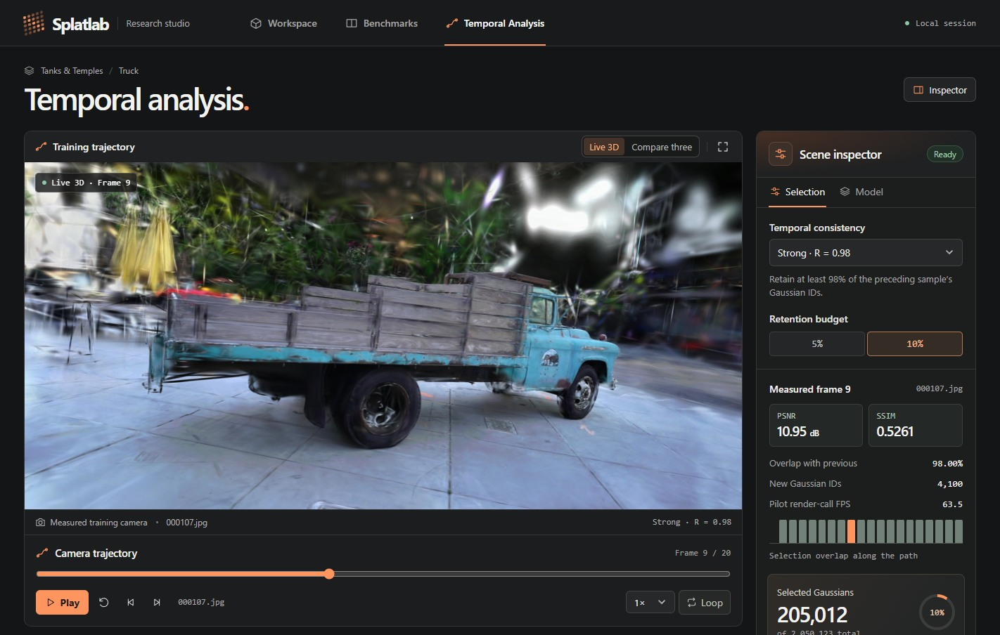
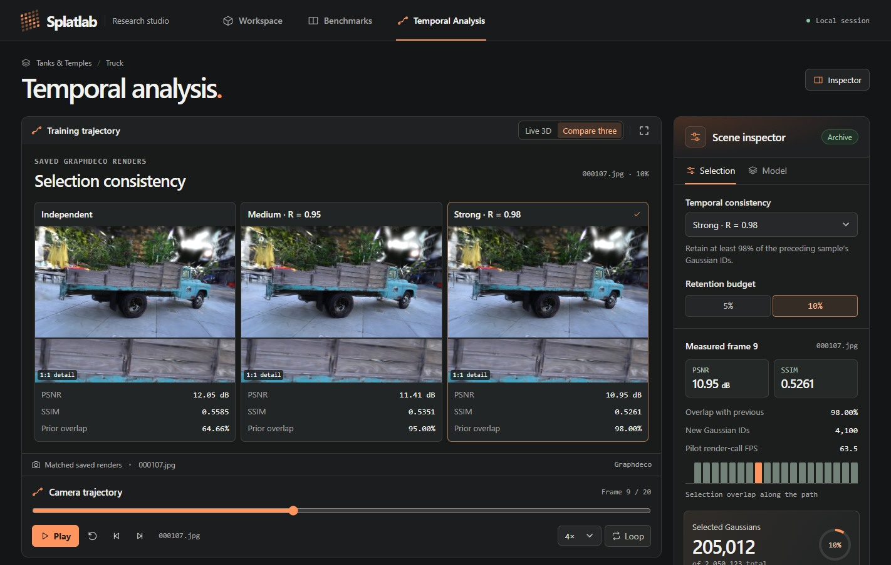
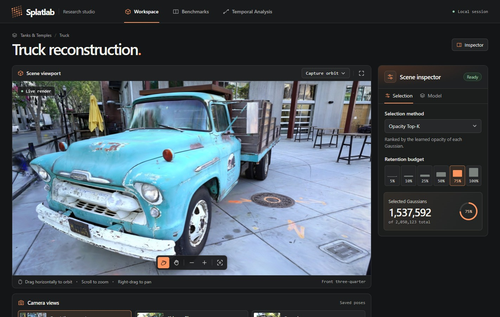
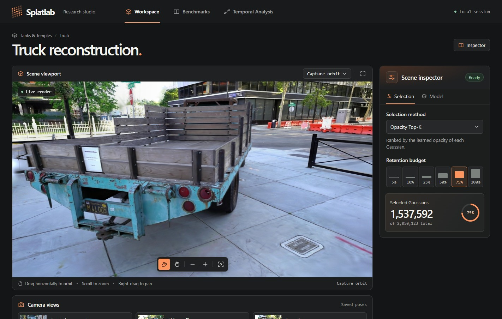

# Milestone 2 · Temporal Gaussian selection on Truck

Splatlab now replays the completed 20-camera rendering pilot. Open **Temporal Analysis**, choose **Independent**, **Medium · R = 0.95** or **Strong · R = 0.98**, select a 5% or 10% budget, and press **Play**. **Live 3D** moves a single Gaussian renderer along the captured trajectory. **Compare three** shows the experiment's three saved renders for the same photograph and budget. [Open Temporal Analysis on the local viewer](http://127.0.0.1:5173/#temporal-analysis)

## Experiment evidence

| Question | Material found and used |
| --- | --- |
| Which cameras were evaluated? | The rendering pilot sampled 20 unique positions from the ordered 219-camera training split. The first image is `000002.jpg` and the last is `000251.jpg`. [Pilot camera manifest](../experiments/temporal_rendering_pilot/camera_subset_manifest.json) |
| Where are the transforms? | The baseline contains 251 camera-to-world transformations, focal lengths and image dimensions. The training sequence supplies the ordered filenames. The join uses the exact filename and checks the loader index. The rendering pilot repeats its auxiliary COLMAP ID, making that field ambiguous. [Baseline calibration](../experiments/baseline_truck/cameras.json) · [Training camera order](../experiments/full_scale_scalability_validation/camera_sequence.csv) |
| Which Gaussians were selected? | There are 120 NumPy arrays, one for each combination of camera, method and budget. Each stores original PLY row IDs as little-endian unsigned 32-bit integers. The manifest records the file digest, sorted-set digest, K and previous-frame shared count. [Selection manifest](../experiments/temporal_rendering_pilot/selection_manifest.json) · [ID arrays](../experiments/temporal_rendering_pilot/selections) |
| What images exist? | The pilot has 120 Graphdeco renders and 20 corresponding ground-truth PNGs at 979 × 546. [Saved renders](../experiments/temporal_rendering_pilot/renders) · [Ground truth](../experiments/temporal_rendering_pilot/ground_truth) |
| What measurements exist? | The pilot has 120 camera-specific PSNR, SSIM, rasterizer-count and timing rows, and 114 adjacent-frame stability rows. [Per-camera measurements](../experiments/temporal_rendering_pilot/results/per_camera_metrics.csv) · [Stability measurements](../experiments/temporal_rendering_pilot/results/temporal_stability_metrics.csv) |
| What does the longer experiment contain? | The separate 219-camera selection study includes transition metrics, initial selections and complete ID deltas, including a weak consistency setting. The full-scale study also includes timings and determinism hashes. Those experiments update history at every training camera. Image-quality figures in this viewer belong exclusively to the 20-camera rendering pilot. [Selection study](../experiments/temporal_selection_pilot/TEMPORAL_SELECTION_PILOT_REPORT.md) · [Complete delta logs](../experiments/temporal_selection_pilot/results/selected_id_deltas_complete) · [Full-scale study](../experiments/full_scale_scalability_validation/FULL_SCALE_SCALABILITY_VALIDATION_REPORT.md) |

The independent pilot selection uses the experiment's camera-specific score, 0.75 × normalized sensitivity + 0.25 × normalized view score. The two temporal methods apply their minimum-overlap constraints in the saved sample order. All three start from the same selection at each budget. The workspace's Opacity Top-K control belongs to a separate experiment. [Rendering pilot report](../experiments/temporal_rendering_pilot/TEMPORAL_RENDERING_PILOT_REPORT.md) · [Research consolidation](../MASTER_RESEARCH_RESULTS_CONSOLIDATION.md)

## Camera and playback

The measured loader indices are 0, 11, 23, 34, 46, 57, 69, 80, 92, 103, 115, 126, 138, 149, 161, 172, 184, 195, 207 and 218. The UI numbers these samples from 1 through 20. At each stop it uses the recorded position and orientation. The camera adapter maps the original right, down and forward axes to Three.js's right, up and backward axes, preserves the Truck world coordinates, and uses both focal lengths from the 1957 × 1091 calibration. Resizing the viewport preserves the calibrated frame within the available aspect ratio. [Camera implementation](src/cameraRig.ts)

Between two measured stops, playback follows the intervening original training cameras in sequence. It linearly interpolates translation and uses shortest-path quaternion interpolation for orientation between neighboring records. The selected IDs stay fixed until the next measured stop. The viewport marks a moving view **Between samples**, and the inspector identifies the measured photograph that owns the displayed metrics.

The archive specifies order but lacks acquisition timestamps. The viewer therefore assigns 1.8 seconds per sample at 1×, with an initial quarter-interval hold for inspection. A new live interval starts once the renderer has the requested subset in its display mapping. Each saved comparison waits for its three images to decode together. Pause preserves the current position, stepping or scrubbing selects an exact measured pose, and looping cuts from the last sample to the first. Playback offers 0.5×, 1×, 2× and 4×. [Playback controller](src/useTemporalPlayback.ts)

## Gaussian identity and memory

The server joins filenames, indices, methods, budgets, set hashes and stability records. On an ID request it verifies the original file's SHA-256, NumPy header and payload length before returning the row IDs in their stored order. The browser validates uniqueness and bounds and uploads a row-lookup texture. Geometry, opacity, color and degree-3 spherical harmonics all read the same original row. [Read-only data service](server/temporal.ts) · [GPU row mapping](src/RankedSplats.ts)

One 508,432,036-byte baseline PLY supplies the 2,050,123 Gaussians for the session. Changing a sample replaces the ID lookup and releases the preceding selection's texture. At 5% the padded lookup occupies 408 KiB on the GPU, and at 10% it occupies 808 KiB. The browser also holds the CPU copy and the renderer's working buffers. Comparison uses the saved PNGs, pauses live rendering, and preloads the next image group during playback. Returning to Workspace restores its previous camera and selection. [Scene renderer](src/TruckScene.tsx) · [Comparison implementation](src/TemporalAnalysis.tsx)

## Reading the measurements

The inspector reports the measured camera, budget, K, PSNR, SSIM and pilot render-call FPS. Previous-frame overlap is 100 × shared IDs / K. **New Gaussian IDs** is K minus the shared count. Frame 1 displays **First frame** because its selection has no predecessor in the pilot. The overlap chart gives each of the 20 measured frames one column.

PSNR and SSIM compare the pilot's saved Graphdeco image with its paired ground truth. Render-call FPS is the reciprocal of the mean of three synchronized CUDA render calls for that configuration. Selection and gathering time are separate columns in the source. **Model → Render diagnostics** reports the browser's last camera-motion sample separately. [Original measurement code](../experiments/temporal_rendering_pilot/run_temporal_rendering_pilot.py)

| Budget / K | Method | Mean PSNR (dB) | Mean SSIM | Mean previous overlap | Mean render-call FPS |
| --- | --- | ---: | ---: | ---: | ---: |
| 5% / 102,506 | Independent | 11.59 | 0.5071 | 61.66% | 71.2 |
| 5% / 102,506 | Medium | 13.10 | 0.5504 | 95.00% | 63.8 |
| 5% / 102,506 | Strong | 13.13 | 0.5508 | 98.00% | 65.1 |
| 10% / 205,012 | Independent | 13.16 | 0.5947 | 67.86% | 80.2 |
| 10% / 205,012 | Medium | 14.32 | 0.6189 | 95.00% | 55.4 |
| 10% / 205,012 | Strong | 14.34 | 0.6184 | 98.00% | 56.6 |

Each quality mean covers 20 measured training cameras. Each overlap mean covers 19 transitions. Temporal consistency improved both quality averages at each budget. Individual cameras can favor independent selection. For example, on frame 9 at 10%, independent selection scored 12.05 dB and strong consistency scored 10.95 dB. The three-way view makes that exception visible alongside the stability gain. [Pilot aggregates](../experiments/temporal_rendering_pilot/results/aggregate_metrics.csv)

## Workspace orbit and inspector

**Capture orbit** is the default for inspecting the truck through a full turn. It chooses photographed views around the subject at distances similar to the starting pose and interpolates between their calibrated transforms. One horizontal drag across the viewport completes a turn. Optical zoom preserves the path. **Free orbit** retains vertical rotation, pan and dolly. The renderer can start its next depth sort as soon as the preceding sort finishes, including while dragging.

The redesigned inspector separates **Selection** and **Model** into keyboard-accessible tabs. Six proportional budget buttons show the active choice, and the count card shows the number of selected rows and their share of the model. At the screenshot's Opacity Top-K setting, 75% retains 1,537,592 rows. The archived 32-view benchmark measures 25.21 dB and 0.8817 SSIM for this setting, versus 25.54 dB and 0.8853 SSIM for the complete model. Backgrounds and sparsely photographed surfaces can still look soft. Original model at 100% provides the full-detail reference. [Opacity benchmark](../experiments/fixed_topk_benchmark/results/aggregate_metrics.csv)

## Validation

| Check | Observed result |
| --- | --- |
| Archive → HTTP → client input | All 120 ID payloads matched the original arrays byte-for-byte. All sorted-set and file hashes, counts, bounds and uniqueness checks passed. All 120 served PNGs matched disk, and all 120 served metric rows matched the CSVs. Both development and built preview servers passed. [Repeatable data audit](tools/verify-temporal.py) |
| Stability | Recomputed all 114 intersections from the served IDs. Every shared count and overlap matched the archive. The six first-frame combinations exposed an empty predecessor. |
| Camera calibration | Reached all 219 original training positions, tested all three camera axes and both focal lengths, and checked 218 intermediate translation midpoints. Sampling the free-standing capture ring once per degree returned to the exact anchor. Maximum distance to the closest original camera was 0.428 scene units, with a median capture radius of 3.864. [Camera tests](tools/camera-rig.test.mjs) |
| Live GPU playback | Chrome presented all 20 measured samples in order during a complete run. Each observed position, camera basis, K and original-ID prefix matched its source. Pause, resume, stepping, scrubbing, reset, loop, speed and fullscreen passed. The same canvas and decoded model object survived all mode changes. [Browser checks](tools/temporal-playback-check.mjs) |
| Live image alignment | For frame 9 at 10% strong consistency, the live capture differed from its saved render by a mean absolute **2.86 levels per RGB channel** on an 8-bit scale. The independent render at that pose differed by 11.27 levels, and the previous strong-consistency camera differed by 67.75 levels. The check fitted the reference to the calibrated 886 × 494 region of the screenshot, excluded the status tag and a two-pixel border, and compared 428,628 pixels. This measures display alignment and includes JPEG and resampling effects. |
| Comparison and regressions | Three complete 979 × 546 renders stayed synchronized at both budgets. Per-card PSNR matched the corresponding source, and arrow keys moved the three detail crops together. Opacity, sensitivity and hybrid selection still displayed 102,506 rows at 5%. The 75% capture orbit passed four quarter-turns and closed at its starting pose. The temporal layout also passed a horizontal-overflow check at 390 CSS pixels. [Selection regression results](validation/selection-smoke-results.json) |
| Data integrity | Re-hashed all 278 protected files against the rendering pilot's pre-execution manifest after implementation. All matched, including the original model, training photographs, checkpoint and research code. [Protected hashes](../experiments/temporal_rendering_pilot/integrity_manifest.json) |
| Build | TypeScript, the Vite production build, the camera tests and the noncontiguous-row shader test passed. Vite reports a bundle-size advisory for the Spark rendering library and the main client bundle. |

## Performance and interpretation

The hardware run used Windows Chrome, ANGLE Direct3D 11 and the NVIDIA GeForce RTX 3050 6 GB Laptop GPU at device pixel ratio 1. The 1,019 × 554 workspace canvas reached Ready in 7.78 seconds from the harness's first status check. At 4× speed, all 20 samples at 10% strong consistency completed in 11.46 seconds, including readiness waits. The browser test observed 391 animation frames between measured stops and zero browser errors. The 32.8 fps reading in the log is a short workspace camera-motion sample.

Fourteen `nvidia-smi` readings taken over the temporal pass ranged from 448 to **458 MiB** of dedicated memory in use across the NVIDIA device. Available system RAM stayed at or above 2,098 MiB of 16,092 MiB reported by the OS. These samples include other processes and can miss brief peaks. The live-motion diagnostics describe this browser and viewport. The results table describes the experiment's CUDA renderer. [RTX run log](validation/workspace-smoke-results.json)

The available research images support quantitative claims at the 20 measured training poses. Playback between poses visualizes the held selection along the capture path. The original experiment provides neither quality scores for those in-between views nor an optical-flow-compensated flicker measurement. Equivalent live and archived images can also differ at fine edges due to Spark's GPU packing, splat rasterization and viewport sampling. The original Graphdeco PNGs remain the reference pixels for comparisons.

## Screenshots

Frame 9 in Live 3D uses the original 10% strong-consistency set for `000107.jpg`. Its inspector shows 4,100 newly selected IDs and 98.00% overlap with frame 8.



The same sample in **Compare three** includes a native-resolution detail strip under each image. Point at a render to inspect the corresponding region in all three, or focus the comparison and use the arrow keys. Select a method's heading to inspect its measurements.



The in-app preview also opened directly at the Temporal Analysis URL and displayed all three methods for frame 2 at 10%. [In-app comparison capture](validation/temporal-preview.jpg)

The workspace inspector at 75% opacity retention and the same configuration halfway around the capture orbit are captured below.





## Reproducing the checks

Start the local development or production preview server as described in the [viewer README](README.md). From the viewer directory, run the following checks with Node 24, Windows Chrome, and the project's Python environment with NumPy and Pillow.

```powershell
node --test tools/ranked-splats.test.mjs tools/camera-rig.test.mjs
python tools/verify-temporal.py http://127.0.0.1:5173
node tools/browser-smoke.mjs
node tools/selection-smoke.mjs
```
