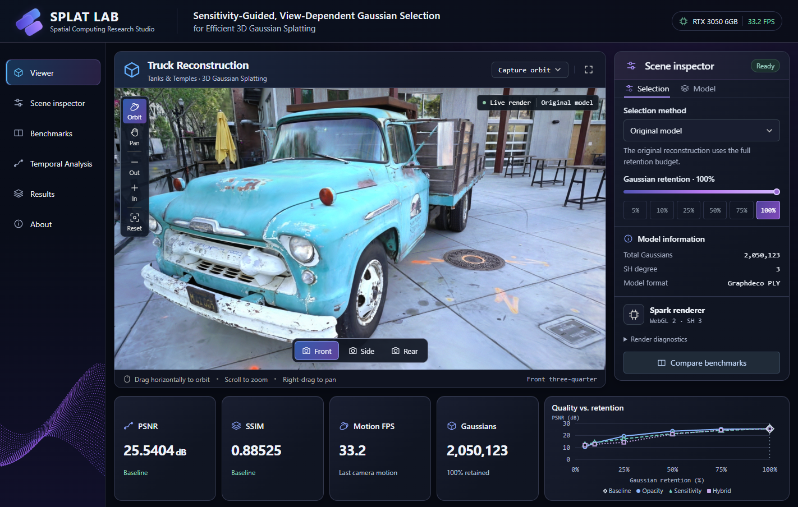
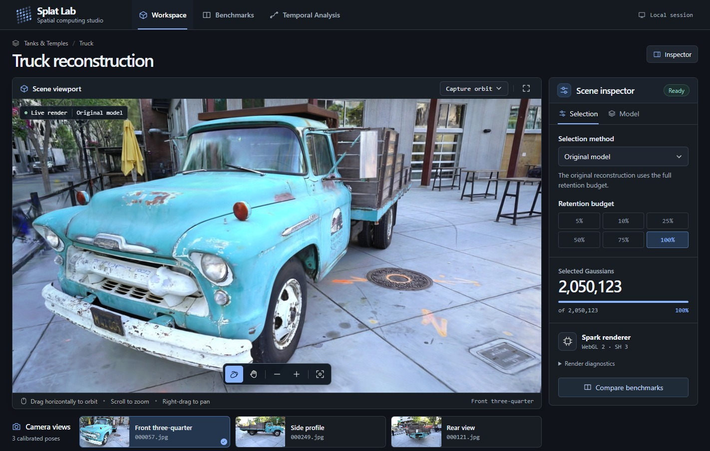
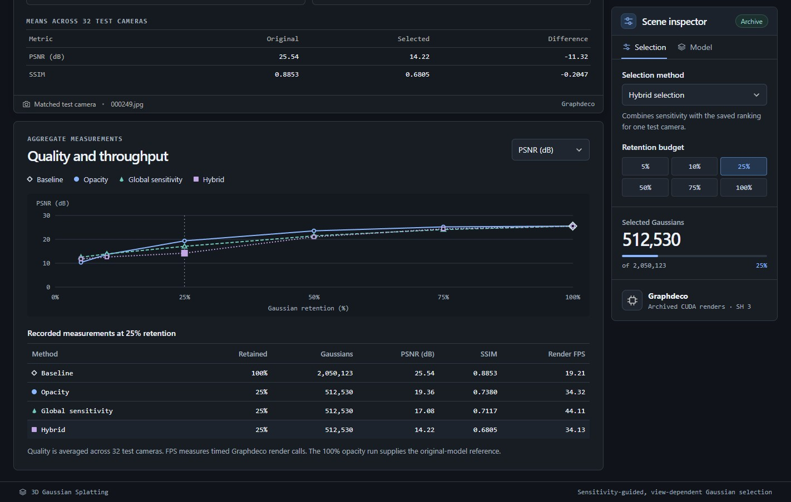
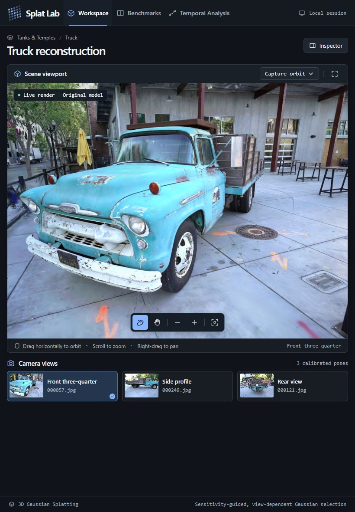

# Splat Lab visual polish

## Purple studio edition

The `purple3dversion` branch starts at the polished viewer commit `43a56ab`. Its desktop layout follows the supplied reference with a purple navigation rail, a vertical tool palette over the live scene, a front/side/rear camera dock, and an inspector beside the canvas. The retention slider snaps to the six experimental budgets. Results opens the archived measurements directly.

The four tiles beneath the scene show archived PSNR and SSIM for the displayed selection, locally measured camera-motion FPS, and the live Gaussian count. The adjacent chart plots measured PSNR against retention for all three selection methods and marks the original-model baseline. The GPU name comes from the browser’s renderer diagnostics.



The production build and all three camera and ranking unit tests passed. The browser decoded the full 2,050,123-Gaussian model with degree-3 SH on an RTX 3050 laptop. The browser check exercised camera navigation and reset, the hybrid retention slider, Results, About, fullscreen, and all 20 temporal samples. Switching views retained the same canvas and model. The final 390-pixel-wide temporal layout passed the horizontal overflow check. All 18 chart records and 576 camera-comparison responses matched the research archives.

## Earlier polished viewer

The Truck workspace gives the live reconstruction **10.4% more canvas area** in the desktop comparison. All three calibrated camera views fit beneath it. The benchmark view now connects the saved image pairs to the measured quality and throughput of all three selection methods.

The work is on `codex/splat-lab-visual-polish`. The existing viewer was untracked on `main`, so commit `1df5203` captures its source, dependencies manifest, test tools, and camera thumbnails before the visual edits. That commit is the comparison point for this report.



## Visual audit and changes

| Area | Finding in the existing viewer | Change |
| --- | --- | --- |
| Workspace | The large heading, outer gutters, and boxed camera section took height away from the canvas. | Tightened the heading and gutters, used a charcoal palette with blue control accents, and moved the three real thumbnails into one desktop strip. |
| Scene controls | The live indicator omitted the displayed selection. The surrounding bars also occupied space in fullscreen. | The readout names the displayed model. Orbit and pan have distinct active states, and the toolbar shows labels on hover and keyboard focus. Fullscreen places the orbit selector and exit control directly over the scene. |
| Inspector | Six small budget glyphs and a separate retention ring competed with the selected count. Renderer details required switching tabs. | Six percentage buttons, an exact count, and a single retention bar share one panel. Renderer details stay accessible in either tab. “Compare benchmarks” carries the active reduced method, budget, and matching saved camera into the comparison. |
| Benchmarks | The image pair and two quality rows covered one selection at a time. The archived timing data was absent. | Added retention curves for PSNR, SSIM, and render-call FPS, a PSNR versus FPS scatterplot, and an exact-value table. Markers and line patterns distinguish the methods. The selected sample is filled, and the baseline has a hollow diamond. |
| Smaller screens | The side-by-side layout left little space for the scene on portrait tablets. | At widths up to 900 CSS pixels the inspector starts collapsed. Portrait tablets use a 4:3 live viewport. Wide tables scroll within their own region. Changing views returns the user to the page heading. |

The React components continue to share one live canvas. UI transitions affect controls and panels, respect reduced-motion preferences, and add no frame callbacks. The PLY loader still streams the single 508,432,036-byte model from the local experiment. The Spark configuration, frame loop, camera rig, selection algorithms, and dependency versions are the same as the baseline commit.

## Benchmark provenance

The viewer reads `results/aggregate_metrics.csv` and `results/timings.csv` directly from each experiment. Count comes from `K`. Quality is the archived mean across 32 test cameras.

| Method | Experiment under `experiments/` | Render-call FPS field |
| --- | --- | --- |
| Opacity | `fixed_topk_benchmark` | `synchronized_render_call_fps` |
| Global sensitivity | `sensitivity_topk_benchmark` | `synchronized_render_call_fps` |
| Hybrid | `sensitivity_view_topk_benchmark` | `render_call_fps_mean` on `budget_summary` rows |

The original-model reference is the archived 100% opacity run. It reports 2,050,123 Gaussians, 25.54 dB PSNR, 0.8853 SSIM, and 19.21 render-call FPS. Each method retains its own measured 100% timing. The inspector labels live browser motion FPS separately. Only display formatting rounds the recorded values.



## Verification

| Check | Observed result |
| --- | --- |
| Production build and unit tests | TypeScript and Vite production build passed. All three camera calibration, orbit, and ranked-splat tests passed. Vite reported its existing large-chunk warning for the 3D libraries. |
| Full reconstruction | Chrome with ANGLE/D3D11 on an NVIDIA GeForce RTX 3050 6 GB Laptop GPU displayed 2,050,123 Gaussians with degree-3 spherical harmonics. |
| Navigation | Browser input changed the orbit position, optical zoom, and pan target. Reset restored the initial camera. Front, side, and rear presets produced distinct views. The workspace entered and exited native fullscreen. |
| Live selection | Exercised opacity, global sensitivity, and hybrid at 5%, 10%, 25%, 50%, 75%, and 100%. Confirmed the displayed count after every switch and changed the hybrid ranking camera. At 100% the renderer displayed the original model. |
| Research figures | All 18 chart records agreed with the quality and timing CSVs. All 576 method, budget, and camera comparison responses agreed on count, quality, deltas, and image paths. The browser displayed the expected table values at each budget and decoded the matching held-out images. |
| Temporal analysis | All 20 calibrated samples played in the existing canvas. Live and saved-image modes, playback controls, and return to Workspace passed. The archive check matched 120 ID arrays, 120 images, 120 metric rows, and 114 adjacent-sample overlaps. |
| Responsive layout | Browser checks passed at 1440 × 900, 1280 × 720, 1024 × 768, 820 × 1180, 768 × 1024, and 390 × 844 CSS pixels. The document had no horizontal overflow. |

## Desktop performance

At the default desktop layout the canvas grew from 1,020 × 554 to 1,059 × 589 CSS pixels. For the timing comparison, both production builds used the full original model, the same GPU, and a fixed 980 × 550 canvas. Chrome ran the builds in baseline–polished–polished–baseline order with its HTTP cache disabled. Each visit included four three-second orbits. Timing excluded the first half-second of each orbit.

| Browser measurement | Baseline | Polished |
| --- | ---: | ---: |
| Median animation-frame cadence during orbit, eight samples | 60.01 FPS | 60.01 FPS |
| Observed cadence range | 56.04–60.01 FPS | 59.60–60.04 FPS |
| Navigation to first ready render, two visits | 34.29 s, 17.65 s | 17.71 s, 19.36 s |

The matched runs showed no observable orbit-cadence regression at the browser’s approximately 60 Hz ceiling. These measurements describe interaction on this laptop. GPU-only frame time, higher refresh rates, and performance on physical tablets were outside the measurement. Load times varied across visits.



## Reproduce the checks

Run these commands from `web-viewer` with the existing dependencies and archived experiments in place. The Python environment used for temporal verification includes NumPy and Pillow.

```powershell
node node_modules/typescript/bin/tsc -b
node node_modules/vite/bin/vite.js build
node --test tools/camera-rig.test.mjs tools/ranked-splats.test.mjs
node node_modules/vite/bin/vite.js preview --host 127.0.0.1 --port 5183
```

With the preview running, use a second terminal for the archive checks.

```powershell
python tools/verify-benchmarks.py http://127.0.0.1:5183
python tools/verify-temporal.py http://127.0.0.1:5183
```
